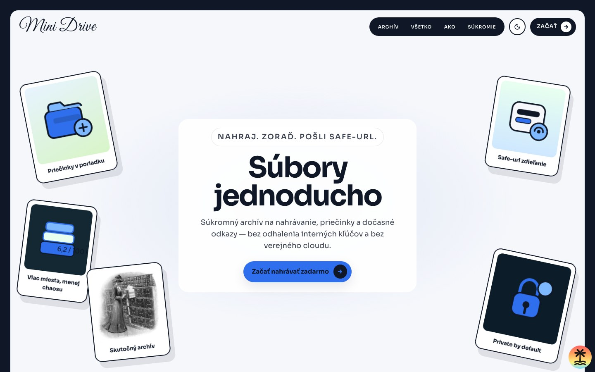
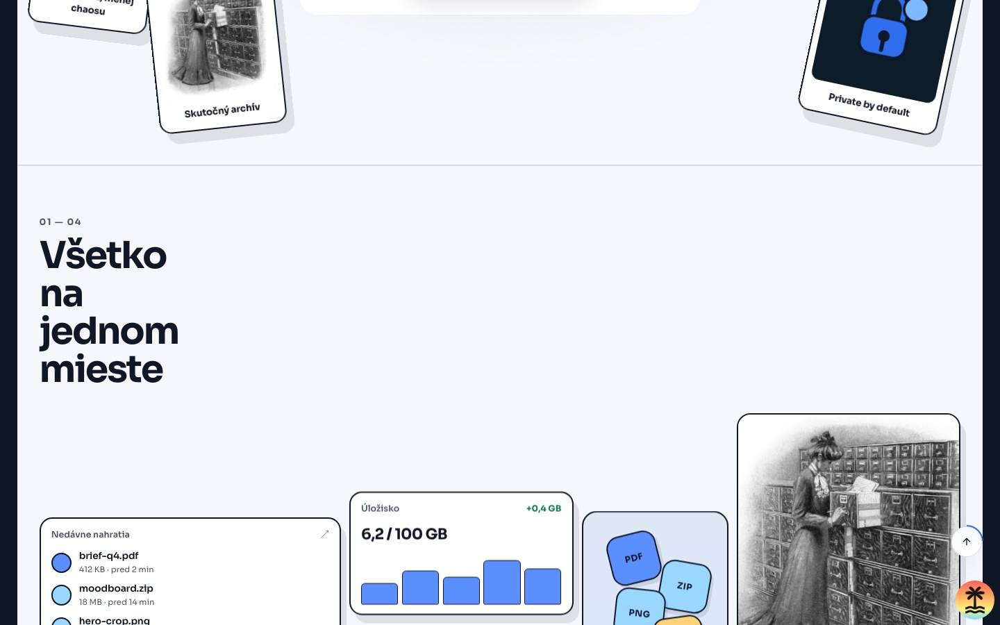
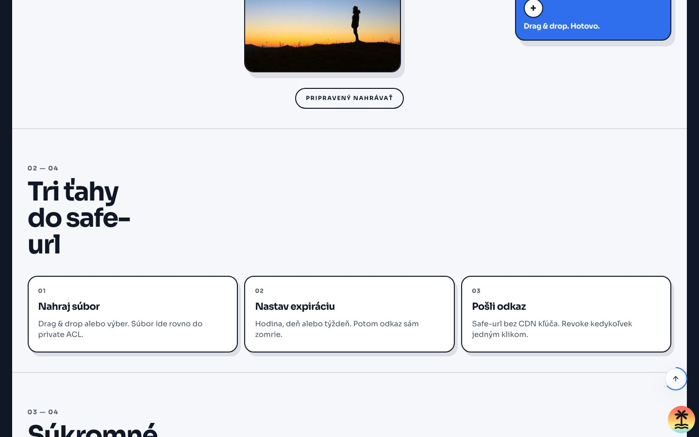

# Mini Drive

Osobné úložisko súborov inšpirované S3 / Google Drive. TanStack Start + Clerk + UploadThing + Drizzle (PostgreSQL) + shadcn/ui.

<p align="center">
  
</p>

| Súbory                                                                   | Safe-url zdieľanie                                                      |
| ------------------------------------------------------------------------ | ----------------------------------------------------------------------- |
|  |  |

## Rozhodnutia stacku

| Oblasť            | Voľba                                         | Zdôvodnenie                                                            |
| ----------------- | --------------------------------------------- | ---------------------------------------------------------------------- |
| Auth              | **Clerk**                                     | Session + middleware pre TanStack Start; lokálny user sync v Postgres. |
| DB                | **PostgreSQL + Drizzle**                      | Produkčný driver (`pg`); schéma cez `drizzle-kit push` / migrate.      |
| Mazanie priečinka | Rekurzívne so súhrnom                         | Drive-like UX; UT súbory sa mažú cez `UTApi.deleteFiles`.              |
| Safe-url          | Vlastný token `/s/$token` → krátky signed URL | Revoke/expirácia v DB; `uploadthingKey` nikdy na klienta.              |

## Požiadavky

- Node 22+
- pnpm 9+
- PostgreSQL 16+ (lokálne alebo Docker)

## Inštalácia

```bash
pnpm install
cp .env.example .env.local
# nastav DATABASE_URL, Clerk kľúče, APP_URL a UPLOADTHING_TOKEN
docker compose up -d db   # voliteľné — lokálny Postgres
pnpm db:push
pnpm dev
```

Otvor [http://localhost:3000](http://localhost:3000).

## Production

### Premenné

| Premenná                   | Účel                                               |
| -------------------------- | -------------------------------------------------- |
| `NODE_ENV=production`      | Prod režim (CSP, HSTS, env guards)                 |
| `APP_URL`                  | Canonical URL, sitemap, robots, CSRF (`https://…`) |
| `DATABASE_URL`             | `postgresql://…` connection string                 |
| `CLERK_*` / `VITE_CLERK_*` | Live Clerk kľúče + dashboard origins               |
| `UPLOADTHING_TOKEN`        | Upload + signed URL (ACL **private** v dashboarde) |
| `AUDIT_IP_PEPPER`          | Hash IP pri share audite (odporúčané)              |
| `BACKUP_ENCRYPTION_KEY`    | Šifrované `pnpm db:backup` / `db:restore`          |

Pri štarte procesu (`pnpm start`) chýbajúce povinné premenné spôsobia hard fail.

### Build & start

```bash
pnpm build
pnpm start   # srvx → dist/server/server.js + dist/client
```

Healthcheck: `GET /api/health` → `{ status: "ok", checks: { database: "ok" } }`.

### Docker

```bash
# VITE_CLERK_PUBLISHABLE_KEY musí byť pri builde (client embed)
docker compose up --build -d
```

Compose spustí `postgres:16` + app. Pred deployom nastav v Clerk a UploadThing produkčný `APP_URL`, potom `pnpm db:push` (alebo migrate) voči produkčnej DB.

### Checklist pred go-live

1. Clerk **live** kľúče + allowed origins / redirect URLs = `APP_URL`
2. UploadThing token + **private** ACL + produkčná app URL
3. Managed Postgres (alebo compose volume `mini-drive-pg`)
4. `AUDIT_IP_PEPPER` + `BACKUP_ENCRYPTION_KEY`
5. Cron / job: `pnpm db:backup` (vyžaduje `pg_dump`)
6. Over `/api/health`, `/robots.txt`, `/sitemap.xml`

SEO: `/sitemap.xml`, `/robots.txt`, `/site.webmanifest`, `/og.svg`.
Súkromné routy majú `noindex`; verejné sú `/`, `/sign-in`, `/sign-up`.
Security headers + CSRF sú v `src/start.ts`.

## Skripty

| Skript               | Popis                      |
| -------------------- | -------------------------- |
| `pnpm dev`           | Vývojový server            |
| `pnpm build`         | Produkčný build            |
| `pnpm start`         | Produkčný server (srvx)    |
| `pnpm typecheck`     | TypeScript                 |
| `pnpm lint`          | Biome lint                 |
| `pnpm format`        | Biome format               |
| `pnpm check`         | Biome check (lint+format)  |
| `pnpm test`          | Vitest raz                 |
| `pnpm test:watch`    | Vitest watch               |
| `pnpm test:coverage` | Coverage report            |
| `pnpm test:e2e`      | Playwright e2e             |
| `pnpm test:k6`       | k6 load (bežiaci server)   |
| `pnpm test:k6:smoke` | k6 smoke                   |
| `pnpm db:push`       | Aplikuj schému do Postgres |
| `pnpm db:backup`     | Šifrovaný `pg_dump` backup |
| `pnpm db:restore`    | Obnova cez `pg_restore`    |
| `pnpm db:studio`     | Drizzle Studio             |

## Load testy (k6)

Vyžaduje [k6](https://grafana.com/docs/k6/latest/set-up/install-k6/) (`brew install k6`) a bežiacu app (`pnpm dev` alebo `pnpm start`).

```bash
pnpm test:k6:smoke              # health + landing + robots + missing share
BASE_URL=http://127.0.0.1:3000 pnpm test:k6
pnpm test:k6:spike              # krátky spike
pnpm test:k6:share-rate         # burst na /s/* → očakáva 429
```

Detaily: [`k6/README.md`](k6/README.md). Unit „stress“ mocky zostávajú vo Vitest (`src/lib/__tests__/stress*.test.ts`).

## Architektúra

```
src/
  routes/           # file-based routing + beforeLoad guards + /s/$token
  components/       # UI (shadcn) + file explorer + share dialog
  server/functions/ # createServerFn mutácie (files, folders, shares)
  db/               # Drizzle schema + Postgres client
  lib/              # auth helpers, CSP, env, rate-limit, share tokens
```

Tok: `/` → session? → onboarded? → `/files` alebo `/onboarding` alebo `/sign-in`.

Verejný safe-url: `/s/$token` → rate limit → aktívny odkaz? → krátky UT signed URL (5 min) · inak **410**.

### UploadThing

Do `.env.local` doplň `UPLOADTHING_TOKEN` z [uploadthing.com](https://uploadthing.com/dashboard).
V dashboarde nastav ACL **private** (alebo povoľ override ACL per-request).

## Dizajn

Notion-inspired: svetlé UI, Figtree + Literata, accent `#2383e2`, jednoduchý sidebar a čistý file explorer. Dark mode cez theme toggle.
